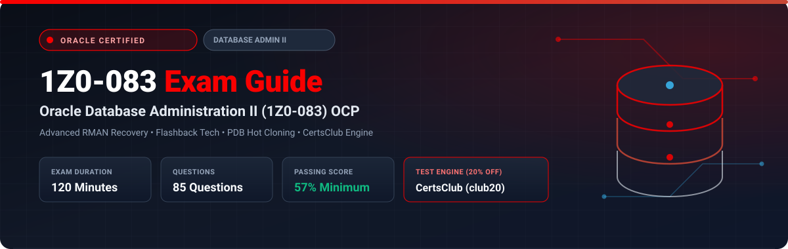

<p align="center">
  
</p>

# Oracle Database Administration II (1Z0-083) Exam Study Guide & Practice Test Resource Portal

[-f80000?style=for-the-badge&logo=oracle&logoColor=white)](https://education.oracle.com/)
[](https://education.oracle.com/)
[-EA1B22?style=for-the-badge)](https://education.oracle.com/)
[](https://education.oracle.com/)
[](https://education.oracle.com/)
[-28a745?style=for-the-badge&logo=shield)](https://www.certsclub.com/oracle/)

---

## 1. Exam Overview & Candidate Profile

The **Oracle Database Administration II (1Z0-083)** exam is the definitive capstone test required to earn the prestigious **Oracle Database Administration 2019 Certified Professional (OCP DBA)** credential. The exam tests advanced skills in multitenant database management, complex RMAN backup, recovery, and point-in-time restore operations, Flashback technologies, instance and SQL performance tuning, database auditing and encryption, and automated database upgrading with AutoUpgrade.

Earning the OCP DBA certification demonstrates to enterprise employers that you are fully qualified to manage, secure, optimize, and recover mission-critical Oracle production databases.

### Target Candidate Profile & Career Roles
* **Senior Oracle Database Administrators (Production OCP DBAs)**
* **Database Infrastructure Engineers & Performance Architects**
* **Mission-Critical Database Reliability & Recovery Engineers**
* **Prerequisites:** Passing 1Z0-082 (Oracle Database Administration I) or holding an active Oracle Database Administrator Associate credential.

---

## 2. Key Exam Specifications

| Parameter | Official Specification |
| :--- | :--- |
| **Exam Code** | 1Z0-083 |
| **Exam Title** | Oracle Database Administration II |
| **Certification Earned** | Oracle Database Administration 2019 Certified Professional (OCP) |
| **Duration** | 120 Minutes |
| **Number of Questions** | 85 Questions |
| **Passing Score** | 57% |
| **Question Format** | Multiple Choice (Single and Multiple Select) |
| **Delivery Vendor** | Pearson VUE / Oracle University Online Remote Proctoring |
| **Recommended Practice Test Engine** | **[1Z0-083 Practice Test - CertsClub](https://www.certsclub.com/oracle/)** (Coupon: `club20` for 20% off) |

---

## 3. Official Blueprint & Exam Domain Breakdown

| Domain Code | Domain Title | Weighting | Key Competencies Covered |
| :--- | :--- | :---: | :--- |
| **1.0** | **Advanced Multitenant Architecture & PDB Management** | **22%** | Hot cloning active PDBs across database links; Relocating PDBs with near-zero downtime; Creating refreshable read-only clone PDBs; Application Containers (Application Root, Seed, and PDBs); PDB snapshot carousels. |
| **2.0** | **Advanced Backup & Recovery using RMAN** | **22%** | Configuring RMAN Recovery Catalog and Virtual Private Catalogs; Incomplete point-in-time recovery (UNTIL TIME, SCN, SEQUENCE); Recovering loss of SYSTEM, UNDO, or Control Files; Tablespace Point-in-Time Recovery (TSPITR); RMAN Duplication techniques. |
| **3.0** | **Flashback Technologies & Disaster Prevention** | **18%** | Flashback Database and Flashback Logs; Flashback Drop and the Recycle Bin; Flashback Table, Flashback Query, and Flashback Versions Query; Guaranteed Restore Points vs Normal Restore Points. |
| **4.0** | **Performance Monitoring, Diagnostics & Workload Tuning** | **20%** | Generating and interpreting AWR, ADDM, and Active Session History (ASH) reports; Automatic SQL Tuning and SQL Tuning Advisor; SQL Access Advisor; Configuring Resource Manager at CDB and PDB levels. |
| **5.0** | **Database Security, Auditing & Upgrades** | **18%** | Unified Auditing policies; Transparent Data Encryption (TDE) software keystores and master keys; Oracle Data Redaction; Automated database upgrading with the AutoUpgrade utility (`autoupgrade.jar`). |

---

## 4. Deep Dive into Complex Exam Topics

### 4.1 Hot Cloning and PDB Relocation with Near-Zero Downtime
In Oracle 19c, pluggable databases can be cloned or relocated while actively running in `READ WRITE` mode using local undo:
```sql
-- Relocating a PDB from a remote CDB:
CREATE PLUGGABLE DATABASE pdb2 FROM pdb1@remote_cdb_link RELOCATE;
-- Finish relocation and open:
ALTER PLUGGABLE DATABASE pdb2 OPEN;
```
* During relocation, queries and DML continue to run on `pdb1` while datafiles are copied across the network.
* When `ALTER PLUGGABLE DATABASE pdb2 OPEN` is executed, Oracle pauses transactions briefly, applies remaining redo, redirects client connections via Oracle Net Services, and drops the source PDB automatically.

### 4.2 Guaranteed Restore Points vs Flashback Database
* **Normal Restore Point:** Stores a mapping of a name to an SCN. It does not prevent flashback logs from being aged out of the Fast Recovery Area (FRA) when space pressure occurs.
* **Guaranteed Restore Point (GRP):** Guarantees that the database can always be flashed back to that exact point in time regardless of `DB_FLASHBACK_RETENTION_TARGET`. Flashback logs are never purged until the GRP is explicitly dropped.
* **Exam Warning:** If the FRA runs out of space because of a GRP, the **primary database will halt**!

---

## 5. Scenario-Based Demo Questions & Technical Explanations

### Question 1: Tablespace Point-in-Time Recovery (TSPITR)
**Scenario:** A developer accidentally dropped a critical schema in the `SALES_DATA` tablespace at 10:15 AM today. You need to perform Tablespace Point-in-Time Recovery (TSPITR) to recover the `SALES_DATA` tablespace to 10:10 AM while keeping all other tablespaces in the CDB available and untouched.

Which RMAN command correctly initiates automated TSPITR?

A)
```bash
RMAN> RECOVER TABLESPACE sales_data UNTIL TIME "TO_DATE('2026-10-08 10:10:00','YYYY-MM-DD HH24:MI:SS')";
```

B)
```bash
RMAN> RECOVER TABLESPACE sales_data UNTIL TIME "TO_DATE('2026-10-08 10:10:00','YYYY-MM-DD HH24:MI:SS')" AUXILIARY DESTINATION '/u01/app/oracle/aux';
```

C)
```bash
RMAN> FLASHBACK TABLESPACE sales_data TO TIME "TO_DATE('2026-10-08 10:10:00','YYYY-MM-DD HH24:MI:SS')";
```

D)
```bash
RMAN> RESTORE TABLESPACE sales_data TO TIME '10:10:00';
```

**Correct Answer:** **B**

**Detailed Explanation:**
* Automated TSPITR requires RMAN to provision an auxiliary instance behind the scenes, restore and recover the target tablespace and required system tablespaces (`SYSTEM`, `SYSAUX`, `UNDO`) in the auxiliary location, export metadata, and plug the recovered tablespace back into the target database.
* Specifying `AUXILIARY DESTINATION` (Option **B**) directs RMAN to automatically manage auxiliary files during the process without manual auxiliary instance configuration.
* Option **A** will fail if an auxiliary destination or auxiliary parameter file is not provided.
* Option **C** and **D** are invalid commands (`FLASHBACK TABLESPACE` does not exist; Flashback operates at table or database level).

---

## 6. Recommended Preparation Strategy & Practice Testing Engine

To pass 1Z0-083 and achieve your OCP DBA:

1. **Practice RMAN Recoveries End-to-End:** Simulate complete loss of control files, loss of system datafiles during peak transactions, and point-in-time incomplete recovery.
2. **Master Performance Diagnostics:** Generate AWR diff reports, execute SQL Tuning Advisor, and configure multi-tenant Resource Manager directives.
3. **Utilize Full-Length Realistic Mocks:** We recommend **[CertsClub Oracle 1Z0-083 Practice Tests](https://www.certsclub.com/oracle/)**.
   * Tests advanced OCP-level scenarios, multitenant operations, and AutoUpgrade configurations.
   * Review detailed technical explanations for every question.
   * Use coupon code **`club20`** at checkout on [CertsClub](https://www.certsclub.com/oracle/) for an instant 20% discount.

---

## 7. Official Documentation & References

* [Oracle Database Backup and Recovery User's Guide 19c](https://docs.oracle.com/en/database/oracle/oracle-database/19/brusb/)
* [Oracle University 1Z0-083 OCP Track](https://education.oracle.com/)
* [CertsClub 1Z0-083 Practice Engine](https://www.certsclub.com/oracle/)

---

## 8. SEO & Discovery Keywords
```
1z0-083, 1z0-083 dumps, 1z0-083 exam questions, oracle dba ocp 1z0-083, 1z0-083 practice test,
oracle database administration II exam, certsclub 1z0-083, rman tspitr, flashback database,
pdb relocate hot clone, autoupgrade oracle 19c
```
